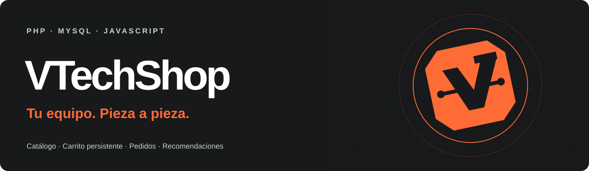
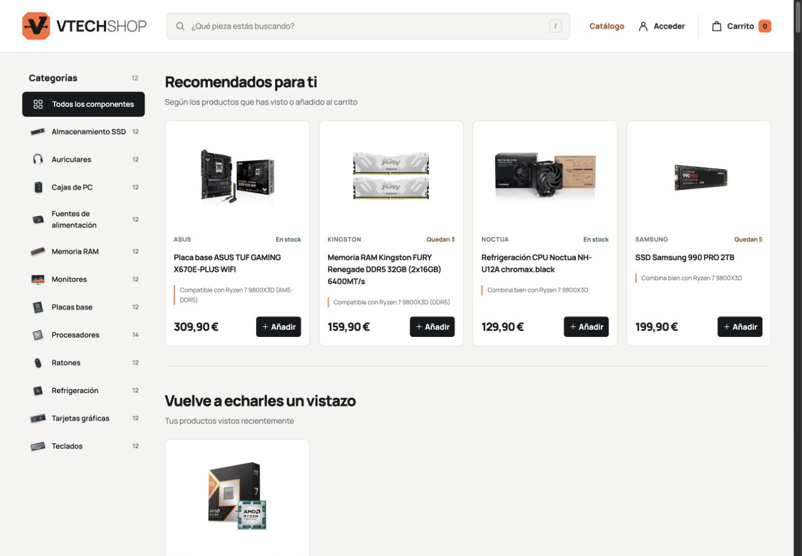
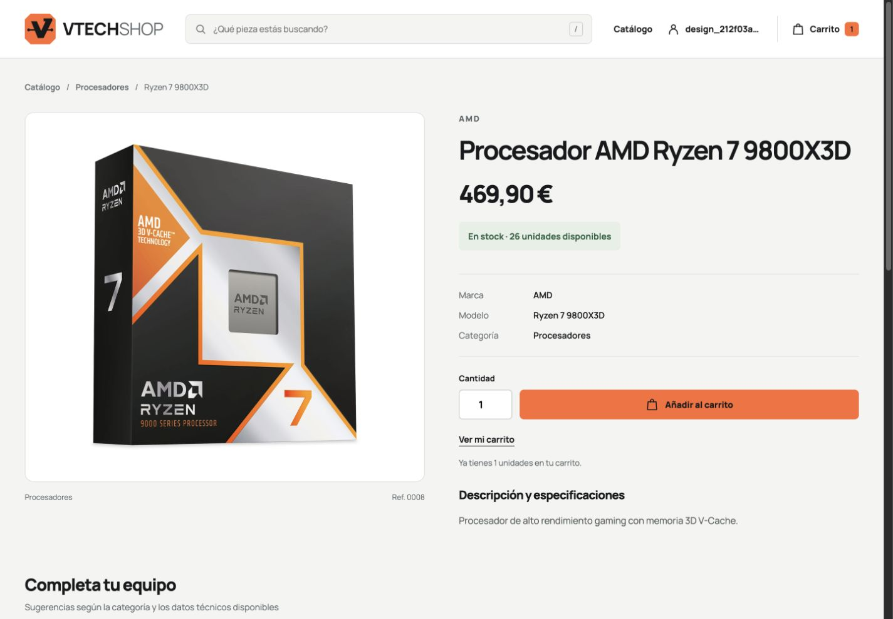
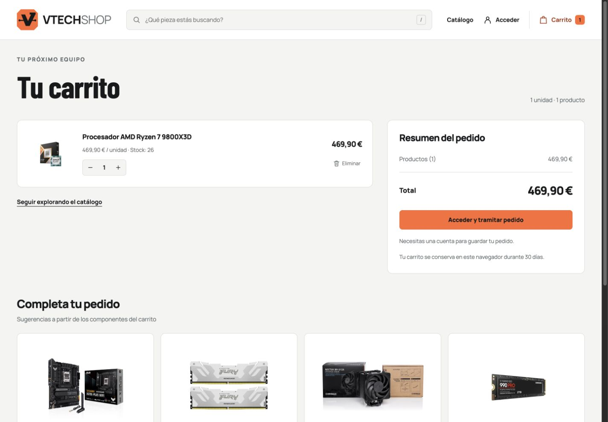
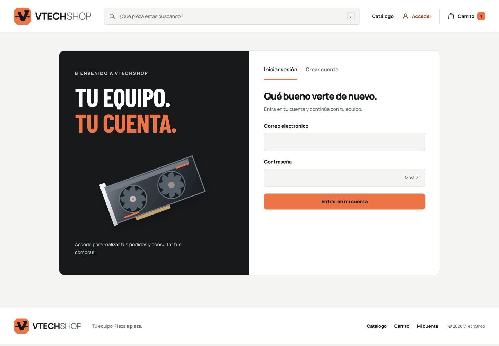
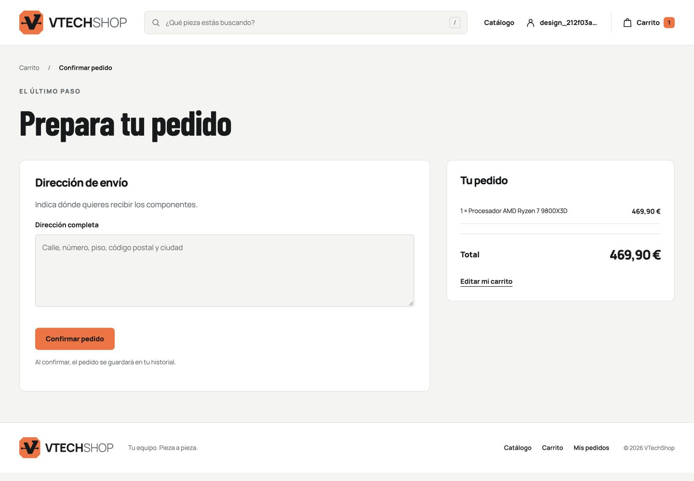
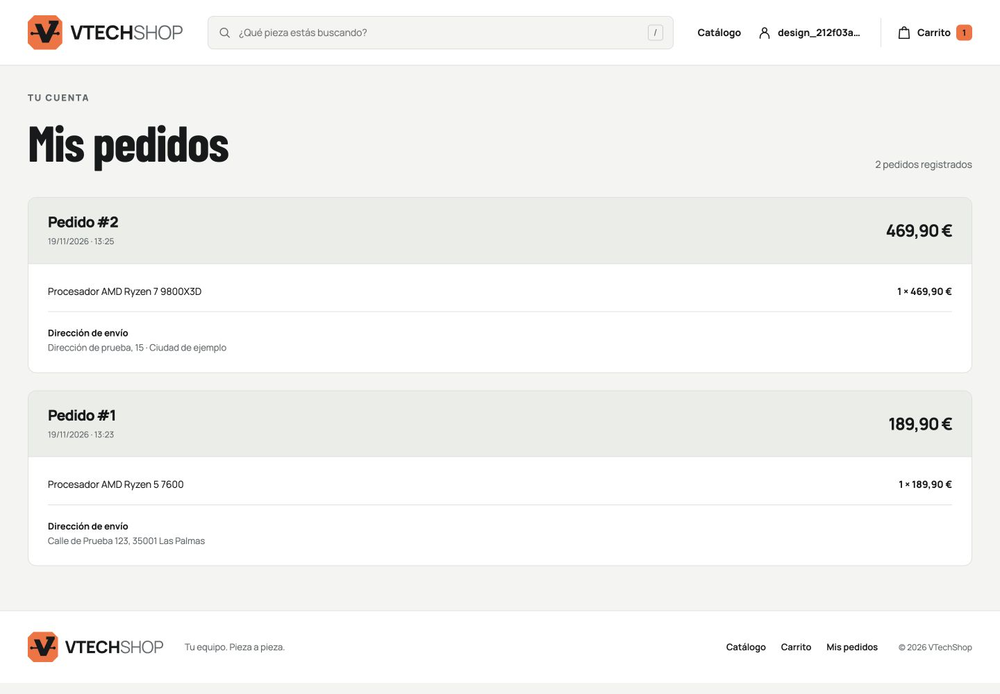
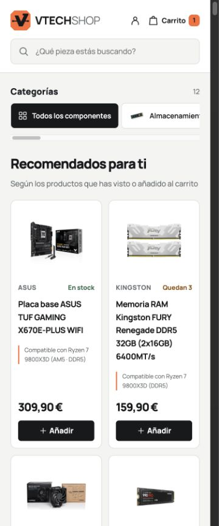
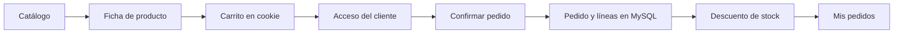

<p align="center">
  
</p>

<p align="center">
  <strong>Una tienda de componentes informáticos hecha con PHP, MySQL y JavaScript.</strong><br>
  Del catálogo al pedido, con carrito persistente y recomendaciones basadas en la navegación.
</p>

<p align="center">
  <a href="#vista-previa">Vista previa</a> ·
  <a href="#arranque-local">Arranque local</a> ·
  <a href="#mapa-del-proyecto">Mapa del proyecto</a> ·
  <a href="#cómo-funciona">Cómo funciona</a>
</p>

---

## Qué puedes hacer

| Recorrido | Funcionalidad |
| --- | --- |
| **Explorar** | Catálogo agrupado por categorías, filtro de categoría y fichas de producto. |
| **Encontrar** | Búsqueda AJAX por producto, marca, modelo y categoría, con sugerencias mientras escribes. |
| **Preparar** | Añadir componentes, cambiar cantidades y eliminar artículos de un carrito guardado en cookie. |
| **Comprar** | Registro/login, dirección de envío, confirmación del pedido y actualización del stock. |
| **Consultar** | Historial de pedidos de la cuenta, con sus líneas, importes y dirección. |
| **Descubrir** | Productos vistos recientemente, complementos, alternativas y recomendaciones personalizadas. |

La base de ejemplo contiene **146 productos en 12 categorías**, desde procesadores, placas base y RAM hasta ratones, teclados y monitores. Incluye **145 fotografías WebP locales** y un único producto sin foto: el **AMD Ryzen 5 5600**, para comprobar el estado alternativo. Los datos se introducen mediante SQL; no existe un panel de administración.

## Vista previa



<details>
<summary><strong>Ver ficha, carrito, acceso y pedidos</strong></summary>

### Ficha de producto



### Carrito persistente



### Acceso a la cuenta



### Confirmación del pedido



### Historial



</details>

<details>
<summary><strong>Ver versión móvil</strong></summary>



</details>

Las capturas utilizan una base de datos temporal con productos del catálogo y una cuenta ficticia. Cuando no hay fotografía, se muestra una **ilustración original de la categoría**, identificada como tal; no pretende representar el modelo exacto.

## Arranque local

### Requisitos

- PHP **8.0 o superior**, con `pdo_mysql`, `mbstring`, JSON y sesiones.
- MySQL/MariaDB con InnoDB.
- Un navegador moderno con JavaScript y cookies habilitados.
- Apache/XAMPP o el servidor de desarrollo incluido en PHP.

**No requiere Composer, Node, npm ni un proceso de compilación.** CSS, JavaScript, fuentes e ilustraciones se sirven desde el propio proyecto.

### 1. Configura la conexión

En [`config/connection.php`](config/connection.php), ajusta estos valores a tu entorno:

```php
$server = "localhost";
$username = "root";
$password = "";
$database = "vtechshop";
```

Las credenciales anteriores corresponden al entorno local de desarrollo. PHP debe poder conectarse al MySQL que hayas arrancado.

### 2. Prepara una base de datos nueva

> **Importante:** `vtechshop_database.sql` comienza eliminando la base `vtechshop`. Este proceso es para una instalación nueva y borra los datos anteriores. No lo ejecutes sobre una base con cuentas o pedidos que quieras conservar.

Desde phpMyAdmin o tu cliente SQL, importa los archivos en este orden:

1. [`sql/vtechshop_database.sql`](sql/vtechshop_database.sql): tablas principales.
2. [`sql/vtechshop_products.sql`](sql/vtechshop_products.sql): categorías y productos.
3. [`sql/vtechshop_recommendations_schema.sql`](sql/vtechshop_recommendations_schema.sql): columnas técnicas y tabla de afinidades.
4. [`sql/vtechshop_recommendations.sql`](sql/vtechshop_recommendations.sql): atributos y relaciones para las recomendaciones.

Si `vtechshop` aún no existe, créala antes del primer paso: el script original usa `DROP DATABASE` sin `IF EXISTS`.

Ejemplo con el cliente de MySQL, desde la raíz del proyecto:

```sh
mysql -u root -p -e "CREATE DATABASE IF NOT EXISTS vtechshop"
mysql -u root -p < sql/vtechshop_database.sql
mysql -u root -p < sql/vtechshop_products.sql
mysql -u root -p < sql/vtechshop_recommendations_schema.sql
mysql -u root -p < sql/vtechshop_recommendations.sql
```

`-p` solicita la contraseña; si tu instalación local la deja vacía, pulsa Enter. El script de estructura de recomendaciones se ejecuta **una sola vez** en una instalación nueva. Si tu base ya tiene `socket`, `memory_type` y `category_affinity`, no lo importes de nuevo.

**Si ya tienes la base de datos y solo quieres incorporar las fotos**, importa únicamente [`sql/vtechshop_products.sql`](sql/vtechshop_products.sql). Asigna las rutas también a los productos existentes y deja el Ryzen 5 5600 sin foto. No modifica sus precios, stock, cuentas ni pedidos; tampoco duplica los productos del catálogo. Las imágenes están incluidas en `assets/products/`, de modo que la tienda no depende de servidores de imágenes externos.

### 3. Abre la aplicación

Con PHP disponible en la terminal:

```sh
php -S 127.0.0.1:8088 -t .
```

Abre **[http://127.0.0.1:8088](http://127.0.0.1:8088)**.

En XAMPP para macOS puedes usar el ejecutable incluido:

```sh
/Applications/XAMPP/xamppfiles/bin/php -S 127.0.0.1:8088 -t .
```

También puedes servir la carpeta desde Apache y acceder a su URL local. En ambos casos, MySQL debe estar iniciado. Para finalizar una compra, crea tu propia cuenta desde **Acceder → Crear cuenta**; no se incluyen contraseñas ni cuentas de administrador predefinidas.

## Mapa del proyecto

```text
VTechShop/
├── index.php                 # Catálogo, categorías y recomendaciones
├── products.php              # Ficha individual y productos relacionados
├── cart.php                  # Vista y actualizaciones del carrito
├── cart-api.php              # Operaciones AJAX del carrito
├── checkout.php              # Dirección y confirmación del pedido
├── orders.php                # Historial de la cuenta
├── search-ajax.php           # Sugerencias de búsqueda en JSON
├── auth/
│   ├── auth-page.php          # Formularios de acceso y registro
│   └── auth-process.php       # Procesamiento y cierre de sesión
├── config/
│   └── connection.php         # Conexión PDO
├── helpers/
│   ├── auth.php               # Sesión e identidad del cliente
│   ├── product.php            # Consultas y agrupación del catálogo
│   ├── cart-cookie.php        # Lectura y escritura del carrito
│   ├── orders.php             # Transacción de compra e historial
│   ├── recommendations.php    # Selección y puntuación de sugerencias
│   ├── currency.php           # Monedas y formato de precios
│   └── errors.php             # Mensajes de error
├── views/
│   └── layout.php             # Cabecera, tarjetas, imágenes y pie
├── assets/
│   ├── css/style.css          # Diseño y adaptaciones a móvil
│   ├── js/app.js              # Búsqueda, carrito y controles de interfaz
│   ├── fonts/                 # Fuentes locales y sus licencias
│   ├── illustrations/         # Ilustraciones SVG de las 12 categorías
│   └── icons/                 # Iconos existentes
├── sql/                       # Estructura y datos de ejemplo
└── docs/                      # Capturas y decisiones de diseño
```

## Cómo funciona



### Sesión y cuenta

La sesión identifica al cliente mediante `user_id` y conserva el nombre y la preferencia de moneda. Las contraseñas se guardan con `password_hash()` y se verifican con `password_verify()`. El identificador de sesión se renueva al acceder. El carrito es independiente de la sesión: cerrar sesión no lo elimina.

### Carrito y cookies

| Dato | Dónde se conserva | Duración y contenido |
| --- | --- | --- |
| Identidad del cliente | Sesión PHP en el servidor | Identificador y datos de la cuenta durante la sesión. |
| `cart` | Cookie del navegador | 30 días; referencias de producto y cantidades. |
| `vtech_history` | Cookie del navegador | 30 días; hasta 12 productos vistos recientemente. |

El precio y el stock se consultan en MySQL. Al abrir el carrito, se ajustan cantidades si ha cambiado la disponibilidad y se informa al usuario. Las cookies pertenecen al navegador: otro navegador o dispositivo no comparte automáticamente ese carrito.

### Pedido y stock

`process_checkout()` abre una transacción, recupera los productos con `SELECT … FOR UPDATE`, comprueba la disponibilidad y calcula el total. Después guarda el pedido, sus líneas con el precio de compra y el descuento de stock. Si algo falla, se revierte la transacción. Tras confirmar correctamente, se vacía la cookie del carrito y se abre el historial del cliente.

### Recomendaciones

El motor utiliza el historial y el carrito como puntos de partida. Combina:

- **Afinidad entre categorías:** por ejemplo, procesadores con placas base o refrigeración.
- **Datos técnicos disponibles:** `socket` y `memory_type` para descartar conflictos conocidos.
- **Precio relativo dentro de la categoría:** aproxima componentes de una gama parecida.
- **Popularidad:** unidades vendidas durante los últimos 90 días.
- **Diversidad:** evita que todas las sugerencias sean del mismo grupo.

Además de sugerencias personalizadas, hay alternativas de categoría y precio parecido, productos vistos y una selección inicial cuando no hay historial suficiente. La interfaz muestra los motivos que devuelve el motor.

La compatibilidad es **parcial**: no comprueba todas las dimensiones, conectores, BIOS, consumo o combinaciones de un equipo completo.

### Interacciones AJAX

| Endpoint | Petición | Respuesta |
| --- | --- | --- |
| `search-ajax.php` | `GET ?q=Ryzen` | Hasta 8 productos con ID, nombre, categoría, precio, stock e imagen. |
| `cart-api.php` | `POST` con JSON: `action`, `product_id`, `quantity` | Resultado, mensaje y recuento actualizado del carrito. |

La búsqueda espera 250 ms después de escribir y empieza con dos caracteres. Las peticiones anteriores se cancelan para evitar resultados desactualizados. Puedes recorrer las sugerencias con las flechas, abrirlas con Enter y cerrarlas con Escape. La tecla `/` enfoca el buscador cuando no estás escribiendo en otro campo.

## Diseño

Grafito, superficies claras y naranja como acento. Titulares con **Barlow Condensed**, lectura con **Manrope** e ilustraciones SVG originales para las categorías sin fotografía. La misma tarjeta, precio, estado de stock y estilo de acción se utilizan en todo el recorrido.

El inicio abre directamente el catálogo, sin hero. El logo original combina una **V, una T y pistas de circuito** en un símbolo de esquinas biseladas. Está en [`assets/brand/logo.svg`](assets/brand/logo.svg), con las letras trazadas para conservar la apariencia sin depender de una fuente instalada; [`mark.svg`](assets/brand/mark.svg) contiene el símbolo y el favicon utiliza la misma identidad.

Las fotos mantienen el producto completo, fondo blanco y presentación común mediante `object-fit: contain`. Se han convertido a WebP conservando la fotografía original. Las fuentes de cada modelo están documentadas en [`docs/product-images.json`](docs/product-images.json).

El diseño incluye adaptación móvil, foco visible, etiquetas de formulario, pestañas de acceso con teclado, avisos del carrito y reducción de movimiento según la preferencia del sistema. Si JavaScript no está disponible, ambos formularios de autenticación permanecen visibles; la búsqueda en vivo y la adición AJAX sí lo necesitan.

La investigación previa y las referencias están en [Decisiones de diseño](docs/diseno.md). Las fuentes se alojan localmente y se distribuyen con sus licencias SIL Open Font License dentro de `assets/fonts/`.

## Alcance del proyecto

- La confirmación **registra un pedido; no realiza un cobro** ni integra una pasarela de pago.
- La preferencia de moneda formatea el símbolo; **no hay conversión de divisas** ni tipos de cambio.
- No hay administración, gestión de transportistas ni seguimiento de envíos.
- Las fotografías son opcionales y se toman de `products.products_image`. No se necesitan para navegar por el catálogo.

## Comprobaciones

La versión visual se ha comprobado con **PHP 8.0.28 y MariaDB de XAMPP**, en una base temporal separada de los datos del usuario:

- Sintaxis de los archivos PHP y JavaScript.
- Catálogo, categorías, ficha, búsqueda y recursos locales.
- Registro, login, errores de credenciales y salida.
- Añadir y actualizar carrito; acceso desde el carrito a la confirmación.
- Registro del pedido, historial y descuento de stock.
- Revisión visual en escritorio y móvil, con comprobación de imágenes y desbordamientos.

Las pruebas y capturas no modifican las cuentas, pedidos ni stock de la base de datos habitual.
